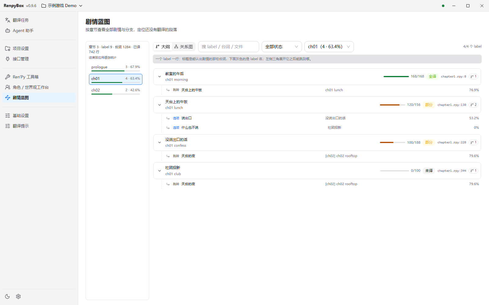

# RenpyBox

  

  
  
  

使用 AI 能力一键翻译 Ren'Py / 视觉小说文本的工具箱

## README 🌍
- [中文（本页）](./README.md)
- [English](./README_EN.md)
- 请不要有中文路径

## 概述 📢
- RenpyBox：集文本提取、翻译、校对、修复与打包于一体的 Ren'Py 本地化工具箱。桌面端（Electron + Web 界面）是唯一前端；旧的 Python / Qt5 界面与打包流程已移除，仓库只保留无界面的 Python 后端与桌面壳。
- 目标用户：视觉小说开发者、同人翻译组、Ren'Py翻译者
- **建议使用[硅基流动](https://cloud.siliconflow.cn/i/Cvmvkm5d) 进行翻译**

0.9.1 桌面版；项目、译文与进度为演示数据

更多界面预览

**Ren'Py 工具箱**（浅色；推荐流程 / 翻译方式 / 资源与词表 / 工程与修复）

**平行校对台**（深色）

**角色 / 世界观工作台**（浅色；含提示词预览）

## 特别说明 ⚠️
- 本工具仅限合法使用。任何利用本工具实施违法、侵权或违法牟利活动的行为，均不受项目方认可或支持；相关法律责任由行为人依法自行承担

## 功能优势 📌
- 桌面界面：翻译任务、平行校对台、Ren'Py 工具箱、角色 / 世界观工作台、Agent 助手；支持浅色 / 深色主题与中英文界面切换（部分文案仍可能显示中文）
- 一键翻译向导：自动检测 `game/tl/<lang>`，支持增量/全量提取、断点续译；任务页可「停止」「继续任务」「写入译文文件」「重翻失败项」
- 术语与禁译：角色名提取、术语表 / 禁翻表本地管理，支持文本保护、前后替换、混合语清理；工作台可维护角色卡与世界观，并预览 / 编辑翻译提示词
- 免费翻译：内置 Google/Bing 免费翻译引擎，无需申请 Key（需可访问对应服务的网络），批量翻译与本地词库均可使用
- 多引擎并发：内置 OpenAI/DeepSeek/Anthropic/Google/火山等模板，可在「接口管理」添加自定义端点；并发任务阈值与 RPM 等在「基础设置」调整
- 高保真格式：AST 补全 + 缺失文本扫描 + miss_patch，同步生成 `replace_text*.rpy` 补丁，保留既有译文
- Ren'Py 工具链：RPY 格式化、缩进/引号检查与修复、尾空格清理、批量字体替换、RPA 解包/打包、RPYC 反编译、语言入口/默认语言设置、安卓打包（安卓外壳打包）
- 进度可视化：翻译任务页展示 token / 进度与任务状态
- Agent 一条龙：在「Agent 助手」里一句话完成解包 → 反编译 → 抽取 → 翻译 → 回填 → 兜底，只确认一次；也可逐步指挥，上下文与轮次上限按所选模型的容量自动推导
- 剧情蓝图：按章节把全部剧情摊开查看，每段剧情标注所在文件行号、台词量与已译进度，配当时的场景画面，并画出「选项 / 跳转」的去向与来源；翻译前就能用来摸清结构，翻译中用来定位还没翻的段落
- 角色关系图谱：从 `.rpy` 里按称谓原文挖出角色关系，`不需要`先翻译或生成世界观；没有数据时按体检结果告诉你下一步该做什么（是没绑工程、没解包，还是还没扫）

## 工具箱模块 🧰
桌面版「Ren'Py 工具箱」共 26 项，分为四组：

- **推荐流程（9）**：继续翻译、一键翻译、检查与润色、应用翻译到游戏、字体注入、添加语言入口、设置默认语言、术语表、禁翻表
- **翻译方式（7）**：RPY 抽取设置、翻译抽取到 TL、直接翻译 RPY、HOOK 翻译、源码翻译、补全翻译、文本提取 JSON
- **资源与词表（4）**：称呼桥接、终极结构导出、批量修正、姓名提取
- **工程与修复（6）**：解包/打包、脚本修复、更新翻译复用、安卓打包、网页 / AI 翻译向导、游戏模组注入

校对可从工具箱「检查与润色」进入，或在翻译任务页打开「平行校对台」。校对保存到翻译缓存；写回游戏请使用「写入译文文件」或「应用翻译到游戏」，编辑校对本身不会自动改写游戏文件。

## 支持的文本格式 🏷️
- Ren'Py 导出 `.rpy`、本地术语表/替换规则
- 其他格式持续补充，欢迎在 Issues 提交需求

## 下载与迁移

从 [GitHub Releases](https://github.com/dclef/RenpyBox/releases) 获取 Windows x64 安装程序或免安装 ZIP。桌面版已附带运行环境，无需另装 Python，详细步骤见[桌面版使用说明](./desktop/README.md)。

发布资产区分：

| 文件 | 用途 |
| --- | --- |
| `RenpyBox-0.9.4-x64.exe` | Windows 安装程序，推荐使用 |
| `RenpyBox-0.9.4-x64.zip` | 免安装包，完整解压后运行其中的程序 |

桌面正式包通过应用内检查更新下载完整安装包，一次跳到最新版（含大小与 SHA-256 校验，校验通过才允许安装）；不提供差分/增量下载。应用配置位于 `%APPDATA%\RenpyBox`（旧版 `RenpyBox-newUI` 目录会在首次启动时自动迁移）；从旧 Python 版迁移时，在「接口管理」点击「新增接口 → 从旧版导入」选择旧版程序目录下的 `config.json` 即可，密钥保存在系统凭据管理器中，会自动沿用。

旧版 SQLite / JSON 翻译缓存仍可使用，升级不会强制转换。需要备份或换机继续时，可在「项目设置 → 工程文件（.rbox）」操作：

1. 先绑定对应游戏，点击「从旧版数据创建工程文件」，选择旧输出目录或其中的 `cache` 目录；支持游戏目录以外的旧数据。
2. 确认预览中的来源、格式、条目数与当前游戏，再选择保存位置。此步骤只新建 `.rbox`，不会修改旧数据，也不会替换当前缓存；文件中的项目设置来自当前应用，不会自动读取旧程序的配置。
3. 在目标位置绑定同一个游戏，点击「导入工程文件」，检查预览后确认。导入会先备份当前缓存，失败时自动恢复。

`.rbox` 是手动快照，继续翻译或修改设置后需再次保存。它包含翻译缓存和允许迁移的项目设置，不包含游戏源文件、接口与密钥；游戏文件请另行保留，接口迁移使用上面的「从旧版导入」。

## 新手快速开始

1. 在「接口管理」选择或添加翻译接口并测试。免费 Google / Bing 无需 Key，但需要能访问对应服务的网络；付费接口按平台要求填写 Key。
2. 在「项目设置」选择输入目录与语言，或打开工具箱「一键翻译」选择游戏目录完成准备。
3. 进入「翻译任务」，确认当前接口与输入 / 输出目录后开始翻译；可用「停止」「继续任务」，失败条目可「重翻失败项」。
4. 通过工具箱「检查与润色」或任务页「打开平行校对台」校对；确认后使用「写入译文文件」。校对不会自动写入游戏文件。
5. 需要时再使用「应用翻译到游戏」、字体注入、添加语言入口或设置默认语言。

## 近期更新 📅

- 2026-10-25 v0.9.8：
  - 移除增量（差分）更新：桌面端与后端统一只下载完整安装包，一次跳到最新版，不再出现「跨版本先下增量、失败再补全量」的重复下载；安装前仍校验大小与 SHA-256
  - 「关于与更新」的下载进度只显示一处百分比
  - 关系图谱新增「AI 推断关系」：按同场共现与人设推断，结果标为 AI 推断，可复核、改手动或否决
  - 剧情蓝图在没有 `scene` 的节点用 `show` 兜底取图，并标注图片来源
  - 修复工作台清洗后按钮点不了；绑定工程时可自动创建并绑定 `.rbox`

- 2026-10-25 v0.9.7：
  - 新增剧情蓝图：按章节查看全部剧情段落，标注文件行号、台词量与已译进度，配当时的场景画面，并画出选项 / 跳转的去向与来源
  - 翻译进度并入应用翻译缓存校对口径；仍会以「占位」标出译文等于原文、实际没翻的段落
  - 新增角色关系图谱：按称谓原文挖关系，不需要先翻译或生成世界观；空态按体检结果给出下一步指引
  - 修复后端为旧版本时剧情蓝图显示英文 `Not Found` 的问题，改为给出可照做的处置提示

- 2026-10-23 v0.9.6：
  - 新增 `.rbox` 单文件工程绑定：导入时选择绑定，翻译进度直接写在这一个文件里；标题栏常驻文件名，工程页可查看条目数 / 大小 / 更新时间并解除绑定
  - 绑定后错误修复、HTML 导入、直接翻译 `tl/*.rpy`、游戏 Mod 等页面自动带出工程目录；源码翻译停止后再开始会续跑，不再重扫与重复备份
  - 修复绑定的工程文件被移动或删除时新建空缓存的问题，移除网盘同步目录提醒

完整记录见 [CHANGELOG.md](./CHANGELOG.md)

## 常见问题 📥
- 桌面版正式包的应用配置与壳日志默认位于 `%APPDATA%\RenpyBox`（旧版为 `%APPDATA%\RenpyBox-newUI`，首次启动会自动迁移）。反馈问题请优先在「运行日志」中导出或打开对应文件。
- 翻译缓存位于**当前输出目录**下的 `cache` 子目录（不是固定的应用 `output/cache`）。暂停后可直接继续任务，或导出已完成部分。
- 若外部接口超时 / 限速，请在「基础设置」调整并发任务阈值与每分钟任务数量（RPM）等，而不是在「接口管理」里改。

## 反馈与支持 💬
- 欢迎通过 Issues/PR 反馈问题或贡献功能
- 反馈问题时请附上相关日志：用「运行日志」导出 / 打开
- QQ 群：821152470

## 致谢 🙏
- 部分代码与架构参考 [AiNiee](https://github.com/NEKOparapa/AiNiee)和 [LinguaGacha](https://github.com/neavo/LinguaGacha)
- 模块的设计理念来自于[renpy-translator](https://github.com/anonymousException/renpy-translator)
- 本工具使用教程请看[RenpyBox使用教程](https://www.bilibili.com/video/BV1KPBoBhEMD)
- 本工具使用文档请看[Renpy汉化教程](https://docs.dclef.com/)
