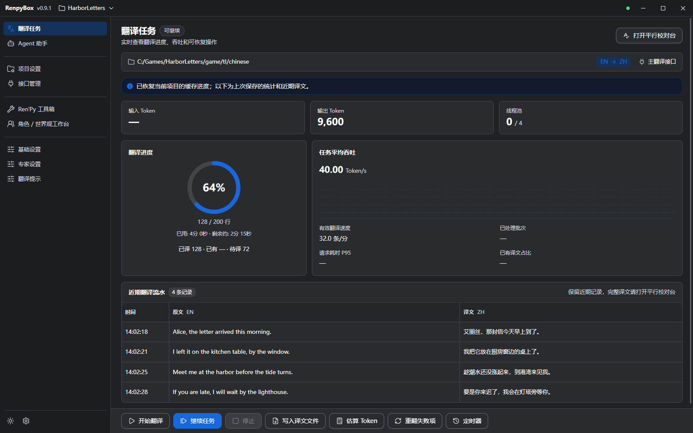
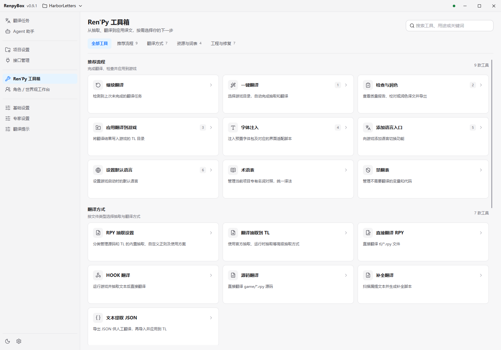
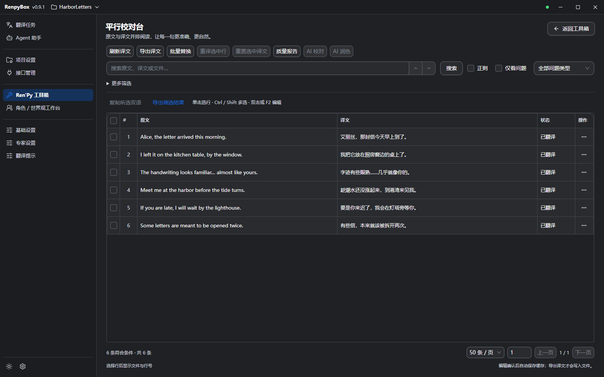
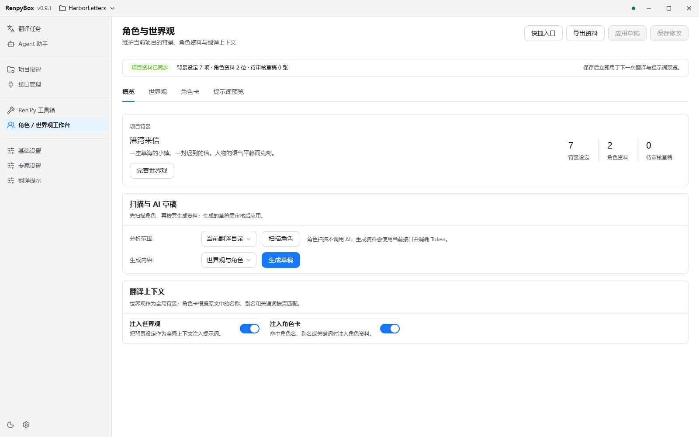

# RenpyBox

  

  
  
  

使用 AI 能力一键翻译 Ren'Py / 视觉小说文本的工具箱

## README 🌍
- [中文（本页）](./README.md)
- [English](./README_EN.md)
- 请不要有中文路径

## 概述 📢
- RenpyBox：集文本提取、翻译、校对、修复与打包于一体的 Ren'Py 本地化工具箱。0.9.0 起提供全新 Windows 桌面界面（当前版本 0.9.1），原 Python / Qt5 版及源码继续保留。
- 目标用户：视觉小说开发者、同人翻译组、Ren'Py翻译者
- **建议使用[硅基流动](https://cloud.siliconflow.cn/i/Cvmvkm5d) 进行翻译**

0.9.1 桌面版；项目、译文与进度为演示数据

更多界面预览

**Ren'Py 工具箱**（浅色；推荐流程 / 翻译方式 / 资源与词表 / 工程与修复）

**平行校对台**（深色）

**角色 / 世界观工作台**（浅色；含提示词预览）

## 特别说明 ⚠️
- 本工具仅限合法使用。任何利用本工具实施违法、侵权或违法牟利活动的行为，均不受项目方认可或支持；相关法律责任由行为人依法自行承担

## 功能优势 📌
- 桌面界面：翻译任务、平行校对台、Ren'Py 工具箱、角色 / 世界观工作台、Agent 助手；支持浅色 / 深色主题与中英文界面切换（部分文案仍可能显示中文）
- 一键翻译向导：自动检测 `game/tl/<lang>`，支持增量/全量提取、断点续译；任务页可「停止」「继续任务」「写入译文文件」「重翻失败项」
- 术语与禁译：角色名提取、术语表 / 禁翻表本地管理，支持文本保护、前后替换、混合语清理；工作台可维护角色卡与世界观，并预览 / 编辑翻译提示词
- 免费翻译：内置 Google/Bing 免费翻译引擎，无需申请 Key（需可访问对应服务的网络），批量翻译与本地词库均可使用
- 多引擎并发：内置 OpenAI/DeepSeek/Anthropic/Google/火山等模板，可在「接口管理」添加自定义端点；并发任务阈值与 RPM 等在「基础设置」调整
- 高保真格式：AST 补全 + 缺失文本扫描 + miss_patch，同步生成 `replace_text*.rpy` 补丁，保留既有译文
- Ren'Py 工具链：RPY 格式化、缩进/引号检查与修复、尾空格清理、批量字体替换、RPA 解包/打包、RPYC 反编译、语言入口/默认语言设置、安卓打包（安卓外壳打包）
- 进度可视化：翻译任务页展示 token / 进度与任务状态

## 工具箱模块 🧰
桌面版「Ren'Py 工具箱」共 27 项，分为四组：

- **推荐流程（9）**：继续翻译、一键翻译、检查与润色、应用翻译到游戏、字体注入、添加语言入口、设置默认语言、术语表、禁翻表
- **翻译方式（7）**：RPY 抽取设置、翻译抽取到 TL、直接翻译 RPY、HOOK 翻译、源码翻译、补全翻译、文本提取 JSON
- **资源与词表（4）**：称呼桥接、终极结构导出、批量修正、姓名提取
- **工程与修复（7）**：解包/打包、错误修复、更新翻译复用、代码格式化、安卓打包、网页 / AI 翻译向导、游戏模组注入

校对可从工具箱「检查与润色」进入，或在翻译任务页打开「平行校对台」。校对保存到翻译缓存；写回游戏请使用「写入译文文件」或「应用翻译到游戏」，编辑校对本身不会自动改写游戏文件。

## 支持的文本格式 🏷️
- Ren'Py 导出 `.rpy`、本地术语表/替换规则
- 其他格式持续补充，欢迎在 Issues 提交需求

## 下载与迁移

从 [GitHub Releases](https://github.com/dclef/RenpyBox/releases) 获取 Windows x64 安装程序或免安装 ZIP。桌面版已附带运行环境，无需另装 Python，详细步骤见[桌面版使用说明](./desktop/README.md)。

发布资产区分：

| 文件 | 用途 |
| --- | --- |
| `RenpyBox-NewUI-0.9.1-x64.exe` | Windows 安装程序，推荐使用 |
| `RenpyBox-NewUI-0.9.1-x64.zip` | 免安装包，完整解压后运行其中的程序 |
| `RenpyBox_v0.9.1.zip` | 保留原界面的 Python 兼容包，供旧版用户更新 |

桌面正式包通过应用内检查更新下载完整安装包（含大小与 SHA-256 校验），与旧 Python 版的增量更新机制不同。原 Python 版可继续使用：旧客户端可先通过原有更新入口获取 Python 兼容包，再由迁移提示前往下载桌面版；也可直接下载安装桌面版。迁移不会自动覆盖旧应用或复制其配置，请在新界面重新确认项目与接口设置。桌面版的应用配置位于 `%APPDATA%\RenpyBox-newUI`，与 Python 版各自独立；需要沿用旧接口时，在「接口管理」点击「新增接口 → 从旧版导入」选择 Python 版程序目录下的 `config.json` 即可，密钥保存在系统凭据管理器中，会自动沿用。

## 新手快速开始

1. 在「接口管理」选择或添加翻译接口并测试。免费 Google / Bing 无需 Key，但需要能访问对应服务的网络；付费接口按平台要求填写 Key。
2. 在「项目设置」选择输入目录与语言，或打开工具箱「一键翻译」选择游戏目录完成准备。
3. 进入「翻译任务」，确认当前接口与输入 / 输出目录后开始翻译；可用「停止」「继续任务」，失败条目可「重翻失败项」。
4. 通过工具箱「检查与润色」或任务页「打开平行校对台」校对；确认后使用「写入译文文件」。校对不会自动写入游戏文件。
5. 需要时再使用「应用翻译到游戏」、字体注入、添加语言入口或设置默认语言。

## 近期更新 📅

- 2026-10-15 v0.9.1：
  - 修复桌面版首次启动接口列表为空的问题，现在会自动准备内置接口模板
  - 「接口管理」新增「从旧版导入」，可直接选择 Python 版程序目录下的 `config.json` 搬回原有接口；密钥保存在系统凭据管理器中会自动沿用

- 2026-10-14 v0.9.0：
  - 推出全新桌面界面（Windows 安装包与免安装版），集成翻译任务、Ren'Py 工具箱、平行校对台、角色与世界观工作台；提示词支持预览与编辑
  - 支持检查更新与下载安装、运行日志查看 / 导出 / 定位；下载安装包增加大小与 SHA-256 校验
  - 优化大批量 TL 文件检查（进度显示与取消），自动修复前保留原文件备份；改善异常恢复与窗口无响应时的重载 / 退出
  - Python 兼容版新增桌面迁移提示；原 Python 应用及源码继续保留

- 2026-10-09 v0.8.2：
  - 修复十万级 Ren'Py 文本写回校验卡顿，保留重复文本、角色名和 AST 优先级检查
  - 修复缓存导出和自动兜底注入误用输出目录，增量与校对导出按运行清单恢复对应输入目录
  - 补全写回路径安全检查，修复单个 TL 脚本首次导出失败

- 2026-10-07 v0.8.1：
  - 修复项目设置里选定的翻译输入目录被改写成 `game/tl/<语言>`，一键翻译跑完后会写回你原本选择的目录
  - 修复保存项目后立刻打开抽取规则对话框被误判成「项目已变化」而清空候选

- 2026-10-02 v0.8.0：
  - 打开模型列表页不再等待加载全部接口库，切换项目和保存翻译缓存明显更快
  - 校对页筛选、相似度与占位符检查提速，十万级文本项目不再反复停顿
  - 修复翻译未完成却提示成功、任务中断丢失进度、单条校验失败中断整份报告的问题
  - 修复多语言项目的运行时替换补丁互相覆盖、写回中断留下损坏译文、回填未完成静默成功的问题
  - 修复抽取规则对话框与校对定位对话框在暗色主题下残留浅色底
  - RPY 抽取设置按读取的语法分类，并说明每份规则被哪些流程共用；未点应用时明确提示

- 2026-09-27 v0.7.12：
  - 新增 RPY 抽取设置，按源码 RPY / TL RPY 分类管理内置、自定义和组合模式
  - 自定义抽取接入一键翻译、TL 翻译和源码翻译，并提供适合新手的默认入口与高级规则编辑
  - 优化 TL 原文配对和源码安全写回，减少自定义规则误选文本
  - 校对支持准确行定位、上下文预览、直接打开文件，以及批量重译进度与取消
  - 改善大项目加载和 Agent 扫描，修复启动脚本选择并保留不同剧情位置的同文译文

- 2026-09-22 v0.7.11：
  - 新增 Google/Bing 免费翻译，无需申请 Key，一键翻译、TL 翻译、源码翻译、直译页与本地词库均可使用
  - 直译页新增“自动写回文件”开关与手动写回按钮，修复开关打开后标签文字不显示的问题
  - 移除 DeepL/DeepLX/彩云/有道/阿里等不再使用的接口，清理历史遗留的兼容模块

- 2026-09-17 v0.7.10：
  - 修复自动更新替换更新器时提示权限不足、导致更新中断的问题
  - 恢复增量更新，版本匹配且安装文件完整时只下载变化文件，减少下载量
  - 本地缺文件、文件损坏或上次更新中断时，自动使用全量包修复
  - 发布前自动验证增量包能否还原完整新版，更新时保留用户配置和输入文件

完整记录见 [CHANGELOG.md](./CHANGELOG.md)

## 常见问题 📥
- 桌面版正式包的应用配置与壳日志默认位于 `%APPDATA%\RenpyBox-newUI`。反馈问题请优先在「运行日志」中导出或打开对应文件；Python 版日志仍位于程序目录下的 `log`。
- 翻译缓存位于**当前输出目录**下的 `cache` 子目录（不是固定的应用 `output/cache`）。暂停后可直接继续任务，或导出已完成部分。
- 若外部接口超时 / 限速，请在「基础设置」调整并发任务阈值与每分钟任务数量（RPM）等，而不是在「接口管理」里改。

## 反馈与支持 💬
- 欢迎通过 Issues/PR 反馈问题或贡献功能
- 反馈问题时请附上相关日志：桌面版用「运行日志」导出 / 打开；Python 版见程序目录下的 `log`
- QQ 群：821152470

## 致谢 🙏
- 部分代码与架构参考 [AiNiee](https://github.com/NEKOparapa/AiNiee)和 [LinguaGacha](https://github.com/neavo/LinguaGacha)
- 模块的设计理念来自于[renpy-translator](https://github.com/anonymousException/renpy-translator)
- 本工具使用教程请看[RenpyBox使用教程](https://www.bilibili.com/video/BV1KPBoBhEMD)
- 本工具使用文档请看[Renpy汉化教程](https://docs.dclef.com/)
