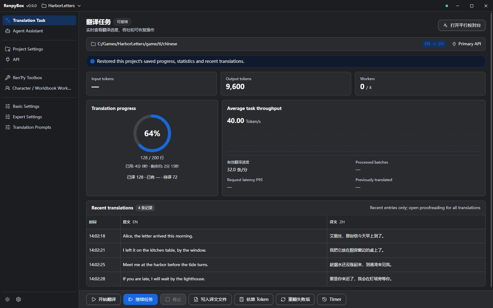
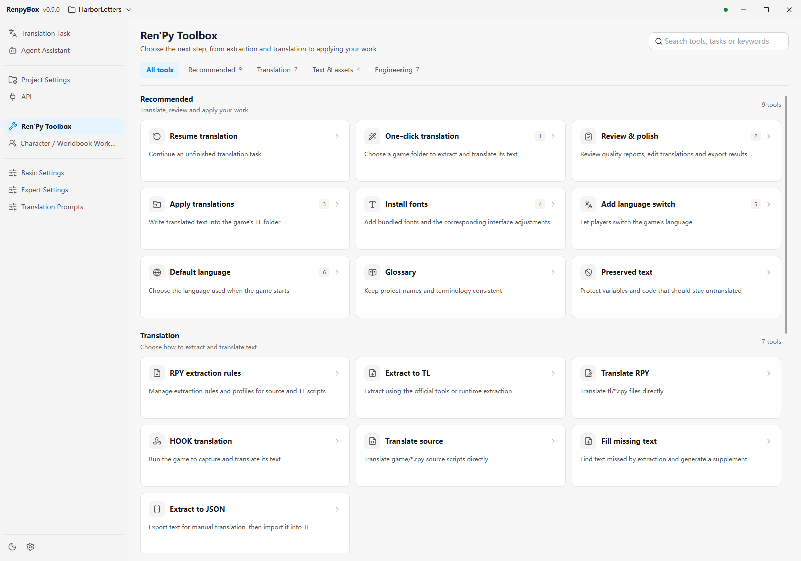

# RenpyBox

  

  
  
  

An AI-powered toolbox for one-click translation of Ren'Py and visual novel text

## README 🌍

- [中文](./README.md)
- English (this page)
- Please avoid Chinese characters in file paths

## Overview 📢

- RenpyBox combines text extraction, translation, proofreading, repair, and packaging in one Ren'Py localization toolbox. The desktop app (Electron + web UI) is the only frontend; the old Python / Qt5 interface and packaging pipeline were removed, leaving a headless Python backend and the desktop shell.
- Intended users: visual novel developers, fan translation teams, and Ren'Py translators.
- **[SiliconFlow](https://cloud.siliconflow.cn/i/Cvmvkm5d) is recommended for translation.**

Desktop 0.9.1; project paths, translations, and progress are demo data

More screenshots

**Ren'Py Toolbox** (light; English UI)

**Proofreading** (Chinese UI, optional)

**Character / Worldbook Workbench** (Chinese UI, optional; includes prompt preview)

## Special Notice ⚠️

- This tool is for lawful use only. Any use of this tool for unlawful, infringing, or illegal profit-making activities is neither endorsed nor supported by the project; the person engaging in such conduct bears the relevant legal responsibility under applicable law.

## Feature Advantages 📌

- Desktop UI: Translation Task, Proofreading, Ren'Py Toolbox, Character / Worldbook Workbench, and Agent Assistant; light / dark themes and Chinese / English UI (some strings may still appear in Chinese).
- One-click translation wizard: automatically detects `game/tl/<lang>` and supports incremental or full extraction and resume from checkpoints. On the task page you can Stop, Continue Task, Write translation files, and Retry failed items.
- Glossary and do-not-translate management: extract character names, manage local glossaries and preserved-text lists, protect text, apply replacements, and clean mixed-language text. The workbench maintains character cards and worldbook entries, with prompt preview and editing.
- Free translation: built-in Google and Bing free engines, no API key required (network access to those services is required); usable for batch translation and the local glossary.
- Concurrent engines: built-in templates for OpenAI, DeepSeek, Anthropic, Google, Volcano Engine, and more; custom endpoints can be added under API. Adjust concurrent-task and RPM limits in Basic Settings.
- High-fidelity formatting: AST completion, missing-text scanning, and `miss_patch` support generate `replace_text*.rpy` patches while preserving existing translations.
- Ren'Py toolbox: RPY formatting, indentation and quote checks and repairs, trailing-space cleanup, batch font replacement, RPA unpacking and packing, RPYC decompilation, language entry and default-language settings, and Android packaging through the Android wrapper workflow.
- Progress visibility: the Translation Task page shows tokens, progress, and task status.
- Story blueprint: lays out every story segment by chapter with its file and line number, line count, and translation progress, draws where each choice / jump goes and where it comes from, and shows the scene image for the moment. Use it to learn the structure before translating and to find untranslated segments while translating.
- Character relationship graph: mines relationships from `.rpy` files using the honorific words in the source text, so it does not require translating or generating a worldbook first; when there is no data it tells you the next step based on a project check (no bound project, not unpacked, or not scanned yet).

## Toolbox Modules 🧰

The desktop Ren'Py Toolbox has 26 tools in four groups:

- **Recommended (9)**: Resume translation, One-click translation, Review & polish, Apply translations, Install fonts, Add language switch, Default language, Glossary, Preserved text
- **Translation (7)**: RPY extraction rules, Extract to TL, Translate RPY, HOOK translation, Translate source, Fill missing text, Text extract JSON
- **Text & assets (4)**: Honorific bridge, Structure export, Batch correction, Name extraction
- **Engineering (6)**: Unpack / pack, Script repair, Translation reuse, Android packaging, Web / AI translation wizard, Game mod injection

Open proofreading from Toolbox **Review & polish**, or from Translation Task via **Open Proofreading**. Edits save to the translation cache; writing back to the game uses **Write translation files** or **Apply translations**. Editing in proofreading does not automatically rewrite game files.

## Supported Text Formats 🏷️

- Ren'Py exports: `.rpy`
- Local glossaries and replacement rules
- More formats will be added over time. Feature requests are welcome in Issues.

## Download and Migration

Get the Windows x64 installer or ZIP from [GitHub Releases](https://github.com/dclef/RenpyBox/releases). The desktop app includes its runtime, so a separate Python installation is not required. See the [desktop guide](./desktop/README.md) for details.

Release assets:

| File | Purpose |
| --- | --- |
| `RenpyBox-0.9.4-x64.exe` | Windows installer (recommended) |
| `RenpyBox-0.9.4-x64.zip` | Portable ZIP; extract fully, then run the app inside |

Desktop packaged builds prefer an incremental update from the previous version and fall back to the full installer for other versions or if the incremental update fails (with size and SHA-256 verification). The app keeps its config in `%APPDATA%\RenpyBox` (the legacy `RenpyBox-newUI` folder is migrated automatically on first launch). To migrate from the older Python app, open **Platforms** and choose **Add Platform → Import from older version**, then select the old app's `config.json`; keys live in Windows Credential Manager and are picked up automatically.

Older SQLite and JSON translation caches remain usable; upgrading does not force a conversion. For backup or continuing on another machine, open **Project Settings → Project File (.rbox)**:

1. Bind the matching game, choose **Create Project File from Older Data**, and select the old output folder or its `cache` folder. Older data outside the game folder is supported.
2. Check the source, format, item count, and current game in the preview, then choose where to save. This only creates an `.rbox` file: older data stays unchanged and the current cache is not replaced. Project settings come from this app; the older program's configuration is not read automatically.
3. Bind the same game at the destination, choose **Import Project File**, and confirm the preview. Import backs up the existing cache first and restores it if import fails.

An `.rbox` file is a manual snapshot: save it again after further translation or setting changes. It contains the translation cache and allowed project settings, without game source files, API platforms, or credentials. Keep the game files separately and use **Import from older version** above to migrate API platforms.

## Quick Start

1. In **API**, select or add a translation interface and test it. Free Google / Bing need no API key, but require network access to those services; paid APIs need keys as required by each provider.
2. In **Project Settings**, choose the input folder and languages, or open Toolbox **One-click translation** and select a game folder to prepare text.
3. Open **Translation Task**, confirm the active API and input / output folders, then start. Use **Stop** and **Continue Task**; failed items can be retried with **Retry failed items**.
4. Review via Toolbox **Review & polish** or **Open Proofreading** on the task page; when ready, use **Write translation files**. Proofreading does not write game files by itself.
5. If needed, use **Apply translations**, install fonts, add a language switch, or set the default language.

## Recent Updates 📅

- 2026-10-25 v0.9.7:
  - Added the story blueprint: lays out every story segment by chapter with its file and line number, line count, and translation progress, and draws where each choice / jump goes and where it comes from.
  - The blueprint shows the scene image for the moment, restored from `scene` statements per chapter.
  - Added the character relationship graph: mines relationships from `.rpy` files using the rule "honorific word × a character variable in the same scene", so evidence is verifiable and no translation or worldbook is needed first.
  - The graph shows a timeline of when each relationship appears by chapter, so the same pair can be compared across chapters.

- 2026-10-23 v0.9.6:
  - Added single-file `.rbox` project binding: choose binding on import and translation progress is stored in that one file; the title bar always shows the file name, and the project page shows entry count / size / last updated and lets you unbind.
  - After binding, error repair, HTML import, direct `tl/*.rpy` translation, game mod, and similar pages auto-fill the project directory; stopping and restarting source translation resumes instead of rescanning and duplicating backups.
  - Fixed creating an empty cache when the bound project file was moved or deleted; removed cloud-sync directory reminders.

- 2026-10-22 v0.9.5:
  - Parallel proofreading now stages changes and saves once; script repair adds Ren'Py Lint re-checks and allows longer waits on large projects.
  - `.rbox` files can be opened with a double-click and show an import confirmation; the installer registers the file association and icon.

- 2026-10-20 v0.9.4:
  - Added `.rbox` snapshots and a guided migration path for older SQLite / JSON caches, with compatibility notes, import previews, and backups.
  - Combined error repair and code formatting into **Script repair**, with safe fixes enabled by default; improved glossary preparation and character / worldbook analysis.
  - Added combined multi-select proofreading filters and cumulative Agent usage metrics; improved truncated-response recovery and fixed deleted history returning and implicit font scans.

- 2026-10-15 v0.9.1:
  - Fixed an empty platform list on the first desktop launch; built-in platform templates are now prepared automatically.
  - Added **Import from older version** under **Platforms**: select the `config.json` in the Python app directory to bring your platforms back; keys live in Windows Credential Manager and are reused automatically.

- 2026-10-14 v0.9.0:
  - New desktop interface (Windows installer and portable build) with Translation Task, Ren'Py Toolbox, Proofreading, and Character / Worldbook Workbench; prompts support preview and editing.
  - Check for updates and install downloads; view, export, and locate runtime logs. Installer downloads verify size and SHA-256.
  - Large TL file checks show progress and can be cancelled; automatic repair keeps a backup first. Improved recovery when a page fails or the window stops responding.
  - Python compatibility build adds a desktop migration notice; the Python app and source remain available.

- 2026-10-09 v0.8.2:
  - Fixed slow write-back validation for large Ren'Py projects while preserving duplicate-text, character-name, and AST matching semantics.
  - Fixed cache exports and fallback reinjection reading from the output directory; incremental and proofreading exports now restore the matching input path from the run manifest.
  - Strengthened write-back path safety checks and fixed first-time export of a single TL script.

- 2026-10-07 v0.8.1:
  - Fixed project-settings translation input folders being rewritten to `game/tl/<language>`; one-click translation now writes back to the folder you selected.
  - Fixed opening the extraction-rules dialog immediately after saving a project being treated as a project change and clearing candidates.

- 2026-10-02 v0.8.0:
  - Opening the model list no longer waits for every translation SDK to load, and switching projects and saving the translation cache are noticeably faster.
  - Proofreading filters, similarity checks, and placeholder checks are faster, so large projects no longer stutter repeatedly.
  - Fixed incomplete translations being reported as success, lost progress after a task stops unexpectedly, and one failing check aborting the whole report.
  - Fixed per-language runtime replacement patches overwriting each other, interrupted write-back leaving damaged translations, and silent success on incomplete backfill.
  - Fixed the extraction-rules dialog and the proofreading target dialog keeping a light background in the dark theme.
  - RPY extraction settings are now grouped by the syntax they read, note which flows share each rule set, and say when a change has not been applied yet.

- 2026-09-27 v0.7.12:
  - Added RPY extraction settings with separate source-RPY and TL-RPY profiles for built-in, custom, and combined modes.
  - Custom extraction is available in one-click, TL, and source translation, with a beginner-friendly default view and optional advanced rule editing.
  - Improved TL pairing and source write-back safety for custom rules.

- 2026-09-22 v0.7.11:
  - Added Google and Bing free translation engines, no API key required; available in one-click, TL, source-code, and direct-RPY translation as well as the local glossary.
  - The direct-RPY page adds an "auto write-back" switch and a manual write-back button; fixed switch labels losing their text when turned on.
  - Removed unused interfaces such as DeepL, DeepLX, Caiyun, Youdao, and Alibaba, and cleaned up legacy compatibility modules.

- 2026-09-17 v0.7.10:
  - Fixed the permission error that interrupted updates when the updater replaced itself.
  - Restored incremental updates: when the version matches and installed files are intact, only changed files are downloaded.
  - Missing, corrupted, or previously interrupted installations are automatically repaired with a full package.
  - Incremental packages are verified before release, and user configs and input files are preserved during updates.

See [CHANGELOG.md](./CHANGELOG.md) for the complete change history.

## FAQ 📥

- Packaged desktop app config and shell logs default to `%APPDATA%\RenpyBox` (legacy `%APPDATA%\RenpyBox-newUI` is migrated automatically). When reporting an issue, prefer **Runtime Logs** to export or open the relevant files.
- Translation caches live in the `cache` subdirectory of the **current output folder** (not a fixed app `output/cache`). After pausing a task, you can continue it directly or export the completed portion.
- If an external API times out or is rate-limited, adjust concurrent-task and RPM limits in **Basic Settings**, not under **API**.

## Feedback and Support 💬

- Issues and pull requests are welcome for bug reports, suggestions, and contributions.
- Please attach relevant logs: use **Runtime Logs** to export or open files.
- QQ group: 821152470

## Acknowledgements 🙏

- Early versions referenced the former Python version of [LinguaGacha](https://github.com/neavo/LinguaGacha); the related code has since been reimplemented. Some code and architecture were adapted from [AiNiee](https://github.com/NEKOparapa/AiNiee).
- The module design was inspired by [renpy-translator](https://github.com/anonymousException/renpy-translator).
- See the [RenpyBox user tutorial](https://www.bilibili.com/video/BV1KPBoBhEMD) for a walkthrough.
- See the [Ren'Py translation documentation](https://docs.dclef.com/) for more information.
